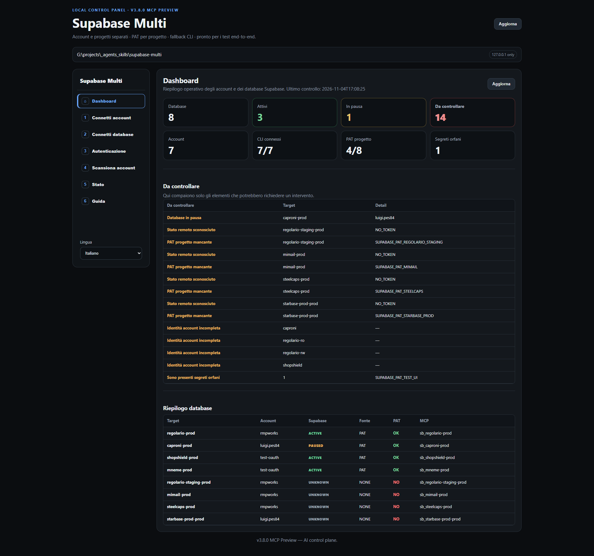

<p align="center">
  <strong>Supabase Multi</strong><br/>
  A local Supabase control plane for humans and AI agents managing multiple accounts and projects.
</p>

<p align="center">
  
  
  
  
  
</p>

<p align="center">
  
</p>

> [!IMPORTANT]
> Supabase Multi is an independent, unofficial open-source project. It is not affiliated with, sponsored by, or endorsed by Supabase.

# Supabase Multi

> **A local Supabase control plane for humans and AI agents managing multiple accounts and projects.**

Supabase Multi is a local Windows control plane for people who work with more than one Supabase account or project and want both humans and AI agents to use the right project, credentials, CLI profile, browser profile, and MCP target without guessing.

It provides:

- a local web dashboard for humans;
- a registry of Supabase accounts and projects;
- isolated Supabase CLI profiles per account;
- isolated browser profiles per account;
- project-scoped PAT management through Windows User Environment variables;
- account-wide project discovery;
- automatic project status checks with PAT-first / CLI-fallback logic;
- MCP target generation and diagnostics;
- repository-to-project routing;
- an MCP server exposing the control plane to AI agents.

Supabase Multi does **not** replace the official Supabase MCP server. It solves a different problem:

> **Supabase Multi decides which Supabase account/project/target an agent should use.  
> The official Supabase MCP server performs the actual Supabase work for that project.**

For most project-level work, the official Supabase MCP server remains the executor. Supabase Multi routes the agent to the correct project-specific target and can also proxy SQL through the official Supabase MCP after resolving the exact project:

- `query_sql(target, query)` forces downstream read-only mode;
- `execute_sql(target, query, confirm=true)` uses the write-capable SQL path and refuses targets configured as read-only.

Other Supabase operations such as logs, advisors, migrations and Edge Functions remain the responsibility of the official Supabase MCP connection.

---

## Why this exists

Working with one Supabase project is easy.

Working with many projects across multiple Supabase accounts is where things become error-prone:

- Which account owns this project?
- Which `project_ref` belongs to it?
- Which PAT should be used?
- Is the PAT scoped correctly?
- Which CLI login is currently active?
- Which browser session belongs to which account?
- Which Supabase MCP target should the AI agent call?
- Is the database active, paused, or unreachable?
- Is a missing PAT actually a problem, or can the CLI profile handle the operation?
- What happens when an AI agent sees several possible projects with similar names?

Supabase Multi centralizes that information in one local control plane.

The human gets a dashboard.

The AI gets MCP tools.

Both read the same source of truth.

---

## Core idea

```text
                         ┌─────────────────────┐
                         │      Human user     │
                         └──────────┬──────────┘
                                    │
                                    ▼
                         ┌─────────────────────┐
                         │   Local Dashboard   │
                         │  127.0.0.1:8765    │
                         └──────────┬──────────┘
                                    │
                                    ▼
┌───────────────────────────────────────────────────────────────┐
│                       Supabase Multi                          │
│                                                               │
│  Registry   CLI profiles   Browser profiles   PAT routing     │
│  Resolver   Status checks  MCP sync            Diagnostics    │
└───────────────────────────────┬───────────────────────────────┘
                                │
                     ┌──────────┴──────────┐
                     │                     │
                     ▼                     ▼
            ┌────────────────┐   ┌────────────────────┐
            │ Supabase Multi │   │ Official Supabase  │
            │ MCP            │   │ MCP targets        │
            └───────┬────────┘   └─────────┬──────────┘
                    │                      │
                    ▼                      ▼
             AI agent/router          Supabase project
```

The Supabase Multi MCP server exposes the control plane.

An AI agent can ask:

```text
Which Supabase project belongs to the repository I am working in?
```

Supabase Multi resolves the target and returns sanitized metadata such as:

```json
{
  "status": "resolved",
  "project": {
    "target": "example-prod",
    "account": "company-main",
    "project_ref": "abcdefghijklmnopqrst",
    "environment": "production",
    "read_only": false,
    "token_env": "SUPABASE_PAT_EXAMPLE",
    "token_present": true,
    "mcp": "sb_example-prod"
  }
}
```

The raw PAT value is never returned.

The agent can then use the correct project-scoped Supabase MCP target.

---

# Features

## Human dashboard

The local dashboard gives a compact operational view of all configured projects.

It shows:

- total databases;
- active databases;
- paused databases;
- projects requiring attention;
- total accounts;
- connected CLI profiles;
- project PAT coverage;
- orphaned secret variables;
- per-project Supabase status;
- status source (`PAT`, `CLI`, or none);
- project MCP target;
- account/project relationships.

The dashboard is designed to answer one question quickly:

> **Is my Supabase setup healthy, and what needs attention?**

---

## Multiple Supabase accounts

Each Supabase account has its own identity and runtime configuration.

Example:

```text
ACCOUNT
├─ alias
├─ label
├─ Supabase email
├─ login method
├─ named Supabase CLI profile
├─ browser preference
├─ isolated browser profile
├─ optional account-wide Discovery PAT
└─ projects
```

CLI authentication is isolated by account through named profiles.

Browser authentication is isolated by account through dedicated Chromium browser profiles.

This avoids the common problem where logging into one Supabase account changes the browser or CLI context for another project.

---

## Multiple projects

Accounts and projects are separate entities.

Example:

```text
PROJECT
├─ target name
├─ label
├─ account
├─ project_ref
├─ environment
├─ operational PAT environment variable
├─ MCP target
├─ read_only
└─ enabled
```

A project belongs to an account, but its operational access token is project-specific.

---

## PAT model

Supabase Multi separates **discovery** from **project operations**.

### Account-wide Discovery PAT

Optional.

Used only to list/discover projects visible to an account.

Recommended permission:

```text
Projects (account-wide): Read
```

### Project operational PAT

Recommended for AI agents and automation.

One scoped PAT per project.

Typical permissions depend on the work the agent must perform. A broad development profile may include:

```text
Project Settings: Read
Advisors: Read
Logs: Read
API Keys: Read
Database: Read-write
Migrations: Read-write
Edge Functions: Read-write
```

Use the narrowest permissions required for your workflow.

For production projects, prefer project scoping, read-only access where possible, and manual approval for write operations.

Official Supabase MCP security guidance:

https://supabase.com/docs/guides/ai-tools/mcp

---

# Security model

Supabase Multi was designed around one rule:

> **AI agents may know where a secret is stored, but they should not receive the secret itself.**

## PAT values are not stored in the registry

The registry stores:

```text
SUPABASE_PAT_EXAMPLE
```

not:

```text
sbp_...
```

The actual value is stored in the current Windows user's environment variables.

## Raw PAT values are never returned by MCP

MCP tools may return:

```json
{
  "token_env": "SUPABASE_PAT_EXAMPLE",
  "token_present": true
}
```

They do not return the token value.

## PAT setup through MCP does not require sending the PAT through the LLM

For AI-controlled workflows, a PAT can be copied locally from one environment variable to the project-configured variable.

Example:

```text
copy_project_pat_from_env(
  target="example-prod",
  source_env="TEMP_SUPABASE_PAT"
)
```

The value moves locally on the machine.

It never needs to appear in the conversation.

## Destructive MCP tools require explicit confirmation

Destructive tools require:

```text
confirm=true
```

Examples include:

- deleting an account;
- deleting a project;
- clearing a project PAT;
- clearing a Discovery PAT;
- deleting orphaned secrets.

## Account deletion is protected

An account cannot be deleted while projects are still associated with it.

## Project deletion does not silently delete secrets

Deleting a project removes its registry entry.

Its PAT environment variable is intentionally preserved and becomes an orphaned secret that can be reviewed and deleted separately.

---

# Project resolution

This is the most important AI-facing feature.

An agent should never guess which Supabase project to use.

The MCP tool:

```text
resolve_project
```

can resolve a target from:

- repository path;
- target name;
- project name or label;
- `project_ref`;
- account.

A repository may declare its Supabase Multi target using:

```text
.supabase-target.json
```

Example:

```json
{
  "version": 1,
  "project": "example",
  "default_target": "example-prod",
  "production_target": "example-prod"
}
```

When an agent works inside that repository, Supabase Multi can resolve the correct project automatically.

---

## Ambiguous resolution rule

**Supabase Multi must never silently guess between multiple valid projects.**

When exactly one project matches:

```json
{
  "status": "resolved"
}
```

When multiple projects match:

```json
{
  "status": "ambiguous",
  "candidates": []
}
```

When nothing matches:

```json
{
  "status": "not_found"
}
```

### Required agent behavior

If the result is `ambiguous`, the AI agent must ask the user to confirm which account/project should be used.

It should **not**:

- pick the first match;
- guess from naming conventions;
- choose the production project automatically;
- return a generic internal error.

Example:

> I found two possible Supabase targets for this request: `example-staging` under `company-dev` and `example-prod` under `company-main`. Which one should I use?

This is a deliberate safety feature.

---

# Requirements

Current release target:

- Windows 10/11;
- Python 3.11+;
- Supabase CLI when using named CLI-profile discovery/fallback;
- Brave, Microsoft Edge, or Google Chrome for isolated Dashboard profiles;
- an MCP-compatible AI client if AI access is required.

The dashboard, PAT-based flows and Supabase Multi MCP can start without the Supabase CLI. CLI-backed account discovery and fallback checks require it.

The MCP Python SDK requires Python 3.11+.

Official SDK:

https://github.com/modelcontextprotocol/python-sdk

---


# Dependencies

Supabase Multi has two different dependency levels.

## Required for Supabase Multi itself

To run the local control plane and its MCP server you need:

- Windows 10/11;
- Python 3.11+;
- Brave, Microsoft Edge, or Google Chrome for isolated Dashboard profiles;
- the Python MCP SDK installed inside `mcp/.venv`.

The Supabase CLI is additionally required for named CLI-profile login, CLI-backed project discovery and CLI fallback checks.

These are enough for:

- the dashboard;
- account/project registry management;
- project discovery;
- PAT and CLI status checks;
- project resolution;
- browser routing;
- MCP synchronization;
- diagnostics;
- orphaned-secret cleanup;
- Supabase Multi MCP tools.

## Required for AI agents to work inside Supabase projects

Supabase Multi uses the **official Supabase MCP server** as its project-level execution boundary. The SQL tools in Supabase Multi proxy to the official MCP using the resolved project and that project's PAT; other project-level operations continue to use the official MCP directly.

Typical project-level operations include:

- inspecting database objects;
- running SQL directly through the official MCP or through Supabase Multi's SQL proxy;
- creating or reviewing migrations;
- reading logs;
- running advisors;
- managing Edge Functions;
- performing development operations.

The relationship is:

```text
AI agent
   │
   ▼
Supabase Multi MCP
   │
   │ resolves account / project / project_ref / MCP target
   ▼
Official Supabase MCP
   │
   │ performs work inside that Supabase project
   ▼
Supabase
```

So the official Supabase MCP server is **not required just to run Supabase Multi**, but it is the recommended companion dependency when AI agents must perform real project-level Supabase operations.

Official Supabase MCP documentation:

https://supabase.com/docs/guides/ai-tools/mcp


# Installation

## Recommended installation

Clone the repository and run the project setup:

```powershell
git clone https://github.com/MacNaym/supabase-multi.git
cd supabase-multi
.\setup.bat
.\start-supabase-multi.bat
```

If you do not use Git, download the repository source ZIP from GitHub, extract it, then run `setup.bat` and `start-supabase-multi.bat`.

`setup.bat` verifies Python 3.11+, reports Supabase CLI availability, creates an isolated Python virtual environment for the MCP server, installs its dependencies, and creates `registry.json` from the example when needed.

The MCP dependencies are intentionally **not** installed into the system/global Python environment.

Expected layout:

```text
supabase-multi/
├─ registry.json
├─ registry.example.json
├─ scripts/
├─ templates/
├─ local-ui/
├─ mcp/
│  ├─ server.py
│  ├─ requirements.txt
│  └─ .venv/
├─ setup.bat
└─ start-supabase-multi.bat
```

`registry.json` is local state and must not be committed.

---

## Developer installation from source

Clone the repository:

```powershell
git clone https://github.com/MacNaym/supabase-multi.git
cd supabase-multi
```

Create the MCP virtual environment:

```powershell
python -m venv .\mcp\.venv
```

Upgrade pip:

```powershell
.\mcp\.venv\Scripts\python.exe -m pip install --upgrade pip
```

Install the MCP SDK:

```powershell
.\mcp\.venv\Scripts\python.exe -m pip install "mcp[cli]>=2,<3"
```

The official MCP Python SDK documents the `mcp[cli]` extra for development and MCP Inspector support.

## Automated verification

GitHub Actions now verifies the public installation surface on Windows. CI:

- compiles the Python sources;
- imports the MCP server;
- runs regression tests for fast local-state reads and secret-field sanitization;
- runs `setup.bat` from a clean checkout;
- verifies the generated MCP virtual environment and local registry;
- starts the control plane and probes `/api/state?local=1`;
- performs a real MCP stdio initialize/tool-discovery handshake;
- runs the SQL proxy safety regression tests;
- runs Gitleaks against the repository history.

See [docs/installation.md](docs/installation.md) for the step-by-step installation guide.

## Updating

For a Git clone:

```powershell
git pull
.\setup.bat
```

Running `setup.bat` again is safe: it reuses the existing virtual environment and does not replace an existing `registry.json`.

Supabase Multi is local-first and does not require a permanently running service. Start it when needed with `start-supabase-multi.bat` or let an MCP client launch `mcp/server.py`.

---

# Starting Supabase Multi

Normal users do **not** need MCP Inspector.

Start Supabase Multi using:

```text
start-supabase-multi.bat
```

The control plane binds locally to:

```text
http://127.0.0.1:8765
```

The dashboard opens in your browser.

The local-only bind prevents the dashboard from being exposed directly to the network.

---

# First-time configuration

## Step 1 — Connect an account

Open:

```text
Connect account
```

Configure:

- account alias;
- display label;
- Supabase email;
- login method;
- preferred browser;
- optional Discovery PAT environment-variable name.

Example:

```text
Alias: company-main
Email: admin@example.com
Login method: GitHub
Browser: Brave
Discovery env: SUPABASE_DISCOVERY_COMPANY
```

---

## Step 2 — Authenticate the Supabase CLI profile

Open:

```text
Authentication
```

Select the account and choose:

```text
Connect Supabase
```

Supabase Multi starts the official Supabase CLI login flow using a named profile for that account.

Complete the login in the opened window.

After refreshing the dashboard, the account should show:

```text
CLI OK
```

Each account uses its own named CLI profile.

---

## Step 3 — Discover projects

Open:

```text
Scan account
```

Choose either:

```text
CLI
```

or:

```text
Discovery PAT
```

CLI discovery uses the account's named Supabase CLI profile.

Discovery PAT mode uses the optional account-wide PAT configured for that account.

Discovered projects can then be imported into Supabase Multi.

---

## Step 4 — Configure project PATs

Each project may define:

```text
token_env
```

Example:

```text
SUPABASE_PAT_EXAMPLE_PROD
```

The token value is stored in the Windows User Environment, not in `registry.json`.

After configuration, use:

```text
Verify access
```

Supabase Multi checks the project using:

```text
project PAT
   ↓
if unavailable/failing
   ↓
named account CLI profile
```

The dashboard shows which source was used.

---

## Step 5 — Synchronize MCP targets

Use:

```text
MCP Sync
```

Supabase Multi generates/synchronizes the configured project MCP targets.

Then run:

```text
Doctor
```

to verify the control-plane configuration.

---

# Dashboard

The dashboard summarizes the entire local Supabase estate.

Key metrics include:

```text
Databases
Active
Paused
Need attention
Accounts
CLI connected
Project PATs
Orphaned secrets
```

The **Needs attention** section highlights:

- paused databases;
- unknown remote state;
- missing project PATs;
- missing account relationships;
- disconnected CLI profiles;
- incomplete account identity;
- orphaned Supabase secret variables.

The **Database overview** shows:

```text
Target
Account
Supabase status
Status source
PAT
MCP target
```

---

# Orphaned secrets

When an account or project is deleted, Supabase Multi does not automatically destroy its PAT environment variable.

This is intentional.

The variable may still be used by another local tool.

Supabase Multi detects Supabase-looking PAT/token environment variables that are no longer referenced by the registry and lists them under:

```text
Status → Orphaned secrets
```

Available actions:

```text
Delete
Clean all
```

Before deleting a secret, the backend rechecks that it is still orphaned.

Raw values are never shown.

---

# AI / MCP integration

Supabase Multi includes its own MCP server.

It exposes the control plane to AI agents over `stdio`.

MCP Inspector is **not required** for normal use.

Inspector is only a development/troubleshooting tool.

---

## MCP architecture

```text
AI client
   │
   │ stdio
   ▼
Supabase Multi MCP
   │
   ▼
Supabase Multi control plane
   │
   ├─ registry
   ├─ CLI profiles
   ├─ Windows secret variables
   ├─ status checks
   ├─ project resolver
   └─ MCP target registry
```

If the dashboard/control plane is not already running, the MCP server can start it automatically.

---

# Connecting an MCP client

Configure your MCP-capable AI client to launch:

```text
<INSTALL_PATH>\mcp\.venv\Scripts\python.exe
```

with:

```text
<INSTALL_PATH>\mcp\server.py
```

Conceptual configuration:

```json
{
  "mcpServers": {
    "supabase-multi": {
      "command": "C:\\path\\to\\supabase-multi\\mcp\\.venv\\Scripts\\python.exe",
      "args": [
        "C:\\path\\to\\supabase-multi\\mcp\\server.py"
      ]
    }
  }
}
```

Exact MCP configuration syntax differs between clients and may change over time.

Check your client's current MCP documentation.

---

# Recommended AI workflow

When an agent needs Supabase access:

```text
1. Resolve the intended project through Supabase Multi.
2. Verify that the result is unambiguous.
3. Verify access/status if needed.
4. Use the returned project metadata and MCP target.
5. Perform project work through the appropriate Supabase MCP connection.
```

Example:

```text
User:
"Check the database security for the project I'm working on."

Agent:
resolve_project(repo_path="C:\\projects\\example")

Supabase Multi:
target = example-prod
account = company-main
mcp = sb_example-prod

Agent:
uses sb_example-prod
```

No manual project selection is necessary when the repository mapping is unambiguous.

---

# MCP tools

The current MCP server exposes **31 tools**.

## Read and routing

### `get_dashboard`
Returns a sanitized operational summary.

### `list_accounts`
Lists configured account metadata.

### `get_account`
Returns one account by alias.

### `list_projects`
Lists configured projects, optionally filtered.

### `get_project`
Returns one exact project target.

### `resolve_project`
Resolves the intended project and returns `resolved`, `ambiguous`, or `not_found`.

### `verify_access`
Verifies project access using PAT first and CLI fallback second.

### `query_sql`
Runs SQL through the official project-scoped Supabase MCP with downstream `read_only=true`.

### `execute_sql`
Runs write-capable SQL through the official project-scoped Supabase MCP. Requires `confirm=true` and refuses targets configured read-only.

### `get_capabilities`
Returns the live server-side capability registry and generation. Useful when a client has stale MCP tool metadata.

### `invoke_capability`
Invokes one operation advertised by `get_capabilities` through a server-side whitelist. Write-capable operations still require explicit confirmation.

### `list_orphaned_secrets`
Returns orphaned environment-variable names only.

## Operations

### `sync_mcp`
Synchronizes configured project MCP targets.

### `doctor`
Runs diagnostics.

### `sync_and_doctor`
Runs MCP synchronization followed by diagnostics.

### `open_project`
Opens the target in the isolated browser profile associated with its account.

### `discover_account`
Discovers projects visible to an account through CLI or Discovery PAT.

## Account administration

### `create_or_update_account`
Creates or modifies account metadata.

### `delete_account`
Deletes an unused account. Requires `confirm=true`.

### `connect_account_cli`
Starts the official Supabase CLI login flow for the named account profile.

### `disconnect_account_cli`
Disconnects the named CLI profile. Requires `confirm=true`.

### `copy_discovery_pat_from_env`
Copies a Discovery PAT locally from an existing environment variable.

### `clear_discovery_pat`
Deletes the configured Discovery PAT variable. Requires `confirm=true`.

## Project administration

### `import_projects`
Imports discovered projects.

### `create_or_update_project`
Creates or modifies a project target.

### `reassign_project`
Moves a project association to another configured account.

### `delete_project`
Deletes the project registry entry. Requires `confirm=true`.

### `copy_project_pat_from_env`
Copies a project PAT locally from another environment variable.

### `clear_project_pat`
Deletes the configured project PAT variable. Requires `confirm=true`.

## Secret cleanup

### `delete_orphaned_secret`
Deletes one orphaned secret. Requires `confirm=true`.

### `clean_all_orphaned_secrets`
Deletes all orphaned secrets. Requires `confirm=true`.

---

# MCP development and Inspector

MCP Inspector is useful when developing or troubleshooting Supabase Multi.

It is not part of the normal user workflow.

From:

```text
supabase-multi\mcp
```

run:

```powershell
.\.venv\Scripts\mcp.exe dev server.py
```

The Inspector should expose all MCP tools.

SDK documentation:

https://github.com/modelcontextprotocol/python-sdk

---

# Registry

Supabase Multi stores configuration metadata in:

```text
registry.json
```

This file contains configuration, not raw PAT values.

The public repository must not contain a real user registry.

Use:

```text
registry.example.json
```

for examples.

Keep:

```text
registry.json
```

in `.gitignore`.

---

# Files that must never be committed

At minimum:

```text
registry.json
browser-profiles/
oauth-sessions.dat
.env
.env.*
*.bak
*.backup
__pycache__/
*.pyc
mcp/.venv/
```

Before publishing a release, run a secret scan over the repository.

---

# Browser isolation

Supabase Dashboard sessions are separate from PAT and CLI authentication.

Supabase Multi does not inject PATs into browser cookies, URLs, or localStorage.

Each account may use an isolated Chromium user-data directory.

Supported targets currently include Brave, Microsoft Edge, and Google Chrome.

---

# CLI isolation

Supabase Multi uses named Supabase CLI profiles.

An account is considered CLI-connected only when:

1. Supabase Multi knows that the named profile is managed by the application; and
2. the exact named profile can successfully list its projects.

This prevents a successful default/global CLI session from being incorrectly reported as the requested account.

---

# Status checking

Project status checks use:

```text
Operational project PAT
        ↓
GET /v1/projects/{project_ref}
        ↓
if unavailable
        ↓
Named Supabase CLI profile
```

The account-wide Discovery PAT is not required for normal project status checks.

Discovery uses the account-wide list endpoint separately.

---

# Relationship with the official Supabase MCP server

Supabase Multi and the official Supabase MCP server are complementary.

## Supabase Multi MCP

Responsible for:

- account selection;
- project selection;
- target resolution;
- local credential routing;
- MCP target selection;
- status visibility;
- local administration.

## Official Supabase MCP

Responsible for project-level Supabase work such as:

- database inspection;
- SQL execution;
- migrations;
- logs;
- advisors;
- functions;
- development operations.

Supabase Multi's `query_sql` and `execute_sql` tools are thin, target-aware proxies to the official MCP `execute_sql` tool; they do not bypass Supabase's own MCP security model.

Supabase recommends project scoping, read-only mode where appropriate, limited feature groups, and review of tool calls for production environments.

Official documentation:

https://supabase.com/docs/guides/ai-tools/mcp

---

# Example AI session

Repository:

```text
C:\projects\shop
```

File:

```text
C:\projects\shop\.supabase-target.json
```

contains:

```json
{
  "version": 1,
  "project": "shop",
  "default_target": "shop-prod",
  "production_target": "shop-prod"
}
```

User asks:

```text
Check the database advisors for this project.
```

Agent calls:

```text
resolve_project(repo_path="C:\\projects\\shop")
```

Result:

```json
{
  "status": "resolved",
  "project": {
    "target": "shop-prod",
    "account": "company-main",
    "mcp": "sb_shop-prod"
  }
}
```

The agent then calls the appropriate Supabase project MCP.

If two projects match, Supabase Multi returns `ambiguous` and the agent must ask the user which one to use.

---

# Troubleshooting

## Dashboard does not start

Verify Python:

```powershell
python --version
```

Verify the local server manually:

```powershell
python .\local-ui\server.py
```

Then open:

```text
http://127.0.0.1:8765
```

## MCP server does not import

Test the SDK:

```powershell
.\mcp\.venv\Scripts\python.exe -c "from mcp.server import MCPServer; print('MCP SDK OK')"
```

Test Supabase Multi MCP:

```powershell
cd .\mcp
.\.venv\Scripts\python.exe -c "import server; print('SUPABASE MULTI MCP IMPORT OK')"
```

## MCP tools are not visible

For development, launch Inspector:

```powershell
cd .\mcp
.\.venv\Scripts\mcp.exe dev server.py
```

## Project shows `UNKNOWN`

Possible reasons include a missing/invalid PAT, insufficient permissions, unavailable named CLI profile, or an unreachable project.

Use `Verify access` or MCP `verify_access`.

## CLI appears disconnected

Reconnect the exact account profile from `Authentication`.

Do not rely on a global/default Supabase CLI login.

## Browser opens the wrong account

Check the account's browser profile configuration and open the project again through Supabase Multi.

## Orphaned PAT variables remain after deletion

This is expected.

Go to:

```text
Status → Orphaned secrets
```

and delete them explicitly after confirming they are no longer used elsewhere.

---

# Repository structure

Recommended public repository layout:

```text
supabase-multi/
├─ README.md
├─ LICENSE
├─ SECURITY.md
├─ .gitignore
├─ registry.example.json
├─ scripts/
├─ templates/
├─ local-ui/
├─ mcp/
│  ├─ server.py
│  ├─ requirements.txt
│  ├─ pyproject.toml
│  └─ .venv/                  # ignored
├─ docs/
│  └─ dashboard.png
├─ setup.bat
└─ start-supabase-multi.bat
```

---

# Design principles

Supabase Multi follows a few deliberately boring rules:

1. **One source of truth.** Human UI and AI MCP use the same local control plane.
2. **Never guess a project.** Resolve it or ask the user.
3. **Never expose PAT values to agents.**
4. **Accounts and projects are different objects.**
5. **Discovery and operations are separate.**
6. **CLI fallback is explicit.**
7. **Destructive actions require confirmation.**
8. **Local by default.** The dashboard binds to `127.0.0.1`.
9. **No browser token injection.**
10. **Portable AI interface.** MCP keeps the control plane independent from any single AI product.

---

# Current platform support

Supabase Multi is currently developed and tested primarily on Windows.

The architecture itself is portable, but the current implementation includes Windows-specific behavior for User Environment secret storage, Chromium profile launching, PowerShell management scripts, and process handling.

---

# Privacy

Supabase Multi is local software.

Configuration and credentials are not sent to a Supabase Multi cloud service because there is no Supabase Multi cloud service.

Network calls made by the application are limited to the services required for its functionality, such as Supabase APIs and the user's configured Supabase projects.

Raw PAT values remain local.

---

# Release checklist

Before publishing a release:

```text
[ ] Run functional UI tests
[ ] Run MCP tool-list test
[ ] Run get_dashboard through MCP
[ ] Run resolve_project through MCP
[ ] Test ambiguous resolution
[ ] Test project PAT access
[ ] Test CLI fallback
[ ] Test account deletion protection
[ ] Test orphan-secret cleanup
[ ] Test fresh installation on a clean environment
[ ] Verify registry.json is ignored
[ ] Verify browser profiles are ignored
[ ] Verify mcp/.venv is ignored
[ ] Run repository secret scan
[ ] Verify no personal email/account/project data remains
[ ] Verify README commands against the release package
```

---

# License

MIT License.

See `LICENSE`.

---

# Disclaimer

Supabase Multi is an independent, unofficial open-source project.

It is **not affiliated with, sponsored by, or endorsed by Supabase**.

Supabase and related product names are trademarks of their respective owners.

---

# Status

Supabase Multi is currently in pre-release testing.

The human control plane and MCP server are functional.

The current MCP implementation exposes **31 tools**. It is covered by real stdio MCP handshake/tool-discovery tests, and the write-capable SQL proxy has been verified end-to-end against a disposable Supabase target.

---

## One sentence version

> **Supabase Multi is a local control plane that lets humans and AI agents safely manage and resolve multiple Supabase accounts and projects without guessing which database, credential, CLI profile, browser session, or MCP target to use.**
